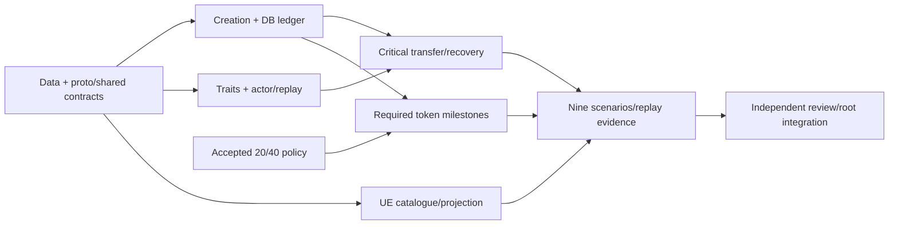

# Phase 2 Plan: Race and Class

**Status:** Final acceptance documentation (closed root receipts). These parts of the local Phase 2 implementation are VERIFIED:

- E4 token provisioning
- required-live UE automation (65 tests)
- the full ordinary native scenario suite (34 files / 29 units)
- the admission backfill counter scrapes
- the Game package stage
- the packaged combat soak (8 clients × 1,200 s, all exits 0)
- the post-merge root Game and Editor builds, with the Class (8/8) and TemplateTarget (1/1) smoke suites.

Root main merged and pushed `cf9225db5cd49432e96de97ffb31e01ad0f3cf94` (the tracked tree `3dcf6b9c8c832ebc2715bef9ec812784a097bd74` is the same as the tested candidate `e568fd2`). The root Game build exit was 0 in 28.43 s, and the Editor build exit was 0 in 19.03 s. The two smoke suites passed with a total of 9/9 and zero failures/skips, and the two exits were 0 (`root-builds/receipt.json`). Local Phase 2 is complete when this final reviewed docs commit merges. The external Linux self-hosted runner is not registered yet. The two-week reliability programme that exists continues as a separate operational follow-up. It is not a local acceptance gate, and it does not start a new 14-day wait. The earlier Oct 9 evidence is historical evidence for the old policy (source 642 suite, 62 live automation tests, 30 files / 25 units, soak `/tmp/phase2-client-final-soak-01`, root `00b9ac1`). The outcome summary [`phase-2-race-and-class-outcome.md`](phase-2-race-and-class-outcome.md) reconciles it. **Author:** agy gemini-3.8-flash-high; bounded revision Codex gpt-6.1-sol / high. The model/effort assignments are below.

## 1. Goal and locked decisions

Deliver these items for **5 races** (Human, Elf, Dark Elf, Orc, Dwarf) and **89 classes** (9 base/18 first/31 second/31 third), with the retail IDs 0..57/88..118: creation, racial identity, exact growth, learned metadata, durable transfers, and Unreal presentation. Keep **cap 85** (`X[86]-1`, SQL 1..85) and **max playable tier 2**, with transfers at 20/40. Tier 3 at 76 is only metadata.

- ALL production creation is at **(0,0)**, and the old 0b behavior stays. The player gets to the Master at **(126,128), radius 3** with normal movement. An explicit owned isolated fixture can seed **(126,126) before admission**. There are no teleports, no new RPCs, and no live progression edits.
- The zone is the only writer. The order is **log ack -> atomic DB checkpoint -> output/RPC success**.
- The real autoGet learning metadata is in scope. Manual purchase and effects are for Phase 3, but the implemented racial static modifiers are not.
- CP is **u32/uint32**, owner-private/reserved, with no absorption. The initial value is 0, and the known maximum is derived. Zero is never full. A transfer keeps the CP/HP/MP percentages, with a floor, and with a minimum of 1 HP for a character that is alive.
- **Token policy implemented and verified** (2026-10-10): Each character gets transfer tokens one time at 20/40. This includes the backfill for eligible characters that exist. The claim bits are authoritative forever. The system never refills a claimed zero, and delevel or death never clears the bits. The system examines each unclaimed tier in ascending tier order. A tier can have a positive balance, or a validated completed current lineage / receipt. In that condition, the system marks the tier claimed and does not add a token. If not, level >= 20/40 grants 1 and marks the tier claimed. Each claim-bit change is critical, also a reconciliation that only marks: log acknowledgement -> atomic checkpoint -> visibility/output. After the upgrade, the first eligible admission of a character that exists uses a deterministic recorded Join critical checkpoint before world visibility. There is no bulk offline SQL backfill, no change to the SQL migration policy, and no frozen receipt change. True live upward crossings use the same helper in ascending tier order. A jump across more than one tier (for example 19→40) covers all the tiers that it crosses. The replay formats are Snapshot 8 / Record 6 / Binary V4 (these are not public wire changes). The old snapshot 7 / record 5 / Binary V3 epochs stay policy-disabled, with no-grant replay. If necessary, recover and durably close the old epoch. Then make a new policy-enabled baseline, and then let live admission start. The system rejects mixed schema 8 / Binary V3. The exact compatibility of older snapshots 4/5/6 and records 3/4 with JsonV1 / BinaryV2 stays. The outer NFR recording format 1 does not change. Production prerequisites: If PostgreSQL is configured, a `NATS_URL` that is not empty is strictly necessary. If it is missing, empty, or only whitespace, the server fails before epoch recovery/admission. A dev setup that is fully ephemeral keeps the explicit warning that data is lost on exit. There are no claims of in-memory replay durability. These items are verified (`root-builds/receipt.json`): the full native suite (34 files / 29 units), required-live automation (65 tests), Game staging, the packaged combat soak (all exits 0), and the post-merge root Game and Editor builds with 9/9 smoke tests.
- Use the curated original Nightfall display names. The IDs/keys/l2_ref stay stable.
- Use shared prototype/placeholder bodies with one hair style/color/face at index 0, and record the two sexes as metadata. This checkout does not import or cook `SKM_Manny_Simple`. Staged remote players use cylinder fallbacks. Different racial/sex bodies are an explicit art limitation, not an approval blocker.

## 2. Source authority and contracts

[Source plan 02](../planning/02-race-and-class.md) has the class references. The linked sources are the integration authority. Examine them on the branches that control them. Root integrates commits, never copies that are not committed. Extensions that are not implemented are **contract candidates**, not claims that the work is complete.

| Source authority | Owner / use |
|---|---|
| [game.proto](../../packages/proto/nightfall/v1/game.proto), [world.proto](../../packages/proto/nightfall/v1/world.proto) | API: additive wire definitions/tags. |
| [class.rs](../../apps/api/src/domain/class.rs), [subclass.rs](../../apps/api/src/domain/subclass.rs) | Data: registry/growth/movement/collision; the Sex/LearnedSkill/ClassProgress/certification/eligible types that exist. |
| [character_progression.rs](../../apps/api/src/domain/character_progression.rs) | API: identity/appearance/ClassState, the full frozen result, bounded receipts; the latest source includes learned_skills and a merge helper. |
| [ports.rs](../../apps/api/src/application/ports.rs), [creation use case](../../apps/api/src/application/use_cases/create_character.rs) | API: runtime/checkpoint/receipt contracts and exact fingerprint semantics. |
| [000007 SQL](../../apps/api/src/infrastructure/postgres/migrations/m20261009_000007_character_classes.sql), [wrapper](../../apps/api/src/infrastructure/postgres/migrations/m20261009_000007_character_classes.rs) | API: final schema/migration names; make the entities again. |
| [class_data.rs](../../apps/api/src/infrastructure/class_data.rs), [data](../../packages/data) | Data: ClassSource embedded/from_dir, load_classes/load_classes_dir -> ResolvedClasses(registry, config_hash). |

### 2.1 Catalogue, stats and learning

Pin the primary L2J High Five XML `3ca488dd2bd0bfaca43e378886a3c2e37968153a`, with reproducible provenance. Keep the Phase 1 classes/oracle. Use new races/professions/growth directories. Validate these items:

- five races and 89 classes
- a base-stat budget of 170
- unique IDs/keys
- acyclic same-race/root parents
- adjacent tiers
- levels 1/20/40/76, and 85 contiguous growth rows (HP>0; MP/CP>=0; source nondecreasing).

Resolve the inheritance. Set the correct parent 28 for Elemental Master 104, and the correct parent 32 for Bladedancer 34.

Use the exact Scaled Q=1_000_000 rows for each current class. The curves are not quadratic, thus quadratic fits and runtime floats are forbidden. **ClassDef movement/collision + sex**, also for mystics, override the race baselines. There are 32 source units for each tile. Calculate these values again at admission/level/delevel/transfer/respawn.

Active racial traits:

- Human: +5% XP, with floor/cap.
- Elf: +3 **run only**, and +3% evasion.
- DarkElf: +5% crit damage, with one rounding and no extra RNG.

Independent vectors define the rounding. Other passive hooks and effects (SP reduction, regeneration, stun, weight, spoil, craft, environmental) are not available in Phase 2. Change the native Human XP expectations with an independent racial oracle, and keep all 19 Phase 1a cases. Never disable live traits.

Real skill scope: **39 trees = 9 base +18 first +12 second slice IDs `2,5,8,9,12,16,17,27,33,46,52,55`**, **6,927 entries**, **3,521 proficiency rows** and **378 known skill references**, for the source levels 1..85. Report the validated actual count. The other second/third trees are not in this slice. If a necessary slice tree is missing, the work is not complete. The remaining 50 direct trees are explicitly deferred, and they inherit the available ancestor metadata. Keep the numeric skill_id, stable key, l2_ref, skill level, getLevel, SP, autoGet, learnedByNpc, and necessary items. Include expertise **239** and the class mastery/proficiency refs. Validate the references/prerequisites/duplicates/inheritance/order. Data and API complete the additive fields/projection. Source comments do not override the approved scope.

At create, transfer, and level, the system resolves the inherited skills with autoGet<=level into the shared ClassState.learned_skills/LearnedSkill. It keeps the maximum for each key, it is deterministic/idempotent, and there is **no SP charge**. Store the normalized learning, slot history, checkpoint, replay, and reconnect data. Delevel keeps this data. The racial keys are validated. granted_skill_keys has only the metadata that is really new or upgraded. An XP upward crossing merges the metadata, but a subsequent transfer from class 0→1 at 20 / class 1→2 at 40 has zero new/upgraded keys. After consumption, the delevels 20→19 and 40→39 keep class 1/2 and the ranks that the character got. Effects and manual purchase are for Phase 3, but racial modifiers are not. Trees that are not empty are valid without effects. Unsupported transfer requirements fail atomically.

### 2.2 Creation and schema

**All RPCs are authenticated, but Ping is not.** Creation validates these items: the race/tier 0 class, the sex/index-zero appearance, and a name of 3..16 ASCII alphabetic characters against the configured case-insensitive blocklist. Keep the display case.

Optional base_class_id presence:

- If it is absent -> the race fighter (Human 0/Elf 18/DarkElf 31/Orc 44/Dwarf 53).
- If it is explicitly 0 -> Human Fighter, which is invalid for Elf.
- If the sex is not specified -> legacy male.

The repeated TurboLink generation must keep the presence. Test the omitted case and the explicit 0 case separately. Keep the legacy semantic retries and the old fingerprint bytes. Use the actual creation source for this, not a copied format. The presence cannot make a saved legacy default request invalid.

Single creation transaction: Lock the account row (or use a transaction advisory lock for a harness without account rows). Do the lookup/claim of idempotency before the slot count. Enforce seven slots. Create the character and the outbox atomically. There is no aggregate FOR UPDATE. A successful retry replays at seven. Old accounts with >7 characters stay, but they cannot create more. From six slots, different concurrent keys give exactly seven. An identical key/body gives one character/event. A name collision gives ALREADY_EXISTS. The eighth gives RESOURCE_EXHAUSTED. A key conflict gives FAILED_PRECONDITION.

API 000007 is responsible for: base/current class, appearance, SP, integer CP, typed counts, mask, and the normalized slots/certifications/receipt refs. The final API schema includes the normalized learned-skill SQL. The DB signed bounds agree with u32/u64. An unknown **or wrong-race** profile aborts. Keep XP/level/HP/MP/alive/position. There are no migration grants and no backfill.

### 2.3 Transfer and critical persistence

Authenticate, then validate UUID/existence/ownership. Then do the account-scoped receipt lookup before the online eligibility. Same key/body -> the **full original frozen result**, also offline or after later changes. A different target/character under the same account/key is a conflict. Different accounts can use the same key. Failures store nothing. **Max 2 successes for each character, forever**, and these receipts are exempt from the 24h cleanup. The integer milli-tile position and all response facts are frozen, and the system never reconstructs them.

ClassTransferRuntime goes through the agreed SessionContext. The API connects it after start_realtime. Actor command: account/character/current **u64 generation**/UUID/target. The oneshot/waiters are outside domain/replay. Only the zone writes progression.

When the ordered command is applied, examine these conditions:

- identity/generation
- alive
- no active combat (own attack/chase/swing/cooldown or incoming engagement)
- fixed-point distance<=3 to the Master
- exact direct parent/race/root
- level 20/40
- tier<=2, and supported token requirements.

If the only possible combat sign is an idle selected target, the command can pass. Unknown/current/sibling/third-tier/no-token/unsupported cases are rejected with no change. Test the squared diagonal distance and the 3.000/3.001 boundary.

If the transfer succeeds, the system does these steps:

- It swaps the growth/maxima.
- It applies floors/clamps to the HP/MP/**CP** percentages (alive HP min 1; a zero old CP max ->0).
- It updates the progress/autoGet.
- It consumes the token one time.
- It drafts the frozen receipt, the public ClassChanged, and the private StatsChanged.

Single-zone account-key race: **max one NEW transfer for each tick**. Complete the draft, then do a second account-wide DB preflight before the next transfer. Followers replay the winner. Keep the eight-command order/budget/bounded queues. A transfer across zones must have a reservation.

Mandatory order: **immutable tick draft -> durable log ack -> revision-fenced atomic DB checkpoint (progression/class/learning/receipts/tokens/mask/outbox) -> frames/RPC success/committed epoch advance**. For a transient failure, retry the identical request with backpressure, and do not make a later draft. A permanent/stale/missing lane/revision **fails closed**: no success, no broadcast, no epoch advance, and no silent recovery close. Reconcile the durable prefix and a lost commit ack before admission. An RPC cancellation cannot cancel a queued mutation. Shutdown closes the waiters. The IDs/ordinals of a level/death/transfer in the same tick are deterministic.

Checkpoint **Option<ClassState>**: Some is the full ledger. None **omits the new fingerprint field and keeps the migrated DB ledger**. A live ProgressionState must have the identity/name/class state. Use the Sex/ClassProgress/shared results again.

### 2.4 Wire, versions and replay

| Additive surface | Locked summary |
|---|---|
| game Character | 7..14 class/root/slot/history/sex/appearance. |
| game CreateCharacterRequest | optional base5; sex6; appearance7..9. |
| game catalogue | ClassInfo source movement14/15/16; skill_tree12/proficiencies13; source metadata extensions and skill_tree_populated17 keep the tags that exist. |
| world EntitySpawn | race15/class16/sex17/appearance18..20/state_tick21; public identity, no CP. |
| world StatsChanged | **uint32 CP8/maxCP9**, class10/SP11/tokens12/13/tick14; owner-private. |
| world ClassChanged | WorldEvent13: entity1/class2/tick3/generation4. |

The replay formats are Snapshot **8** / Record **6** / **Binary V4** (these are not public wire changes). Keep the historical **Binary V3**. It stays for the disabled no-grant replay: recover the old epoch -> durable close -> new policy-enabled baseline -> live admission. Keep **BinaryV2/JsonV1 exactly**, together with the older snapshots **4/5/6** and records **3/4**. The registry is optional only in the explicit old replay mode. All new live players have traits. The system explicitly rejects mixed schema 8 / Binary V3 pairs. The old decode/re-encode keeps the absent fields/bytes, without a disk registry or new ticks. JsonV1 must have omit-absent/zero or an immutable legacy view. Defaults alone fail.

Binary V4 sets the semantic policy boundary. It hashes the persisted state (identity, class, SP, CP, token balances and claims, learning, receipt, full frozen result, and order) with a new separator and ordered integers. The transient grant-mask fields stay as in-memory lifecycle state, and V4 does not hash them into the persisted state. V4 does not include pointers/oneshot/checkpoint I/O. The snapshot records the registry/rules/Master/hash, and replay does not read the current disk. Validate the restore. Share and hash the registry one time. The outer NFR recording format 1 does not change.

The snapshot compression and payload numbers from the old V3 (2,060,904 raw -> 152,362 compressed bytes, against the JetStream payload limit) are explicitly historical. The current codec, payload bounds, and server gates are verified. Coordinate the separately versioned compression/adapter/root service validation. Never remove metadata/receipts, and do not use record bounding as a snapshot fix. Do not make a NATS change that is not validated.

Spawn-before-reference and the current identity apply to late AOI/replacement/reconnect/causal owner stats. The client uses tick/generation fences, and a delayed RPC cannot duplicate cues. The domain u64 must stay exact, although the wire has a u32 saturation debt.

### 2.5 Subclass reservation

The actual `subclass::eligible(registry, context, candidate)` has these conditions: main level 75+ and a completed second tier, **quest OR noble**, a tier 2 candidate, and <3 held subclasses. It excludes Overlord/Warsmith, an Elf/DarkElf crossing, and professions that are the same as, or equivalent to, the main or held classes. As in the source, resolve the tier 3 held classes to their tier 2 ancestors. Test each equivalence group/denial. Reserve slots 1..3, four certifications for each subclass (12 max), independent progress, and a future cap of main level minus five. Runtime switching/acquisition/certification effects/UI are off.

## 3. Epics, stories, models and Done When

Models: **D = agy gemini-3.8-flash-high**, **C = Codex gpt-6.1-sol / high**, **Z = Codex gpt-6-astra / high**. Z examines the critical contracts independently. The rows give the work and the acceptance conditions. The outcome summary records the verified and pending gates.

### E1 — Race/class data and traits

| Story | Work / Done When | Model |
|---|---|---|
| 1.1 Source catalogue | Make 5 races/89 classes/exact 85-row growth with pinned provenance. Reproduce the goldens, and keep the Phase 1 data and the production `(0,0)`. | D |
| 1.2 Loader/registry | Validate the stats/tree/refs/inheritance/hash. Malformed/cyclic/race/tier/growth errors fail the startup. Inputs in a different order keep the same hash. | D |
| 1.3 Learning metadata [client-visible] | Deliver 39 trees/6,927 learning rows and the expertise/mastery refs. Report the count. The inherited create/level/transfer merge keeps the maximum levels, charges no SP, and returns the actual grant keys. | D |
| 1.4 Subclass rules | Use the `eligible`/reservation types again. Test level/tier, quest-or-noble, forbidden/cross-race/main/held/equivalent, and the slot/certification limits. The runtime is off. | D |
| 1.5 Racial stats/CP [client-visible] | Current-class growth/movement/collision and three racial effects. Independent vectors prove the reserved zero CP/percentages without absorption. | Z |
| 1.6 Simulation scenario(s) [client-visible] | `2-racial-traits.nfs` covers 1.5 and the 1.3 metadata that the client can see. The client stats agree with the independent oracle, and the effects availability is correct. | C |

### E2 — Creation and persistence

| Story | Work / Done When | Model |
|---|---|---|
| 2.1 Wire [client-visible] | Additive fields/auth catalogue/metadata and repeatable bindings. The compatibility round trips keep the optional explicit ID 0. | C |
| 2.2 Schema/name validation [client-visible] | Race/root/sex/appearance/blocklist. Tests assert the name boundaries 2/3/16/17, the charset/case, and the UI errors. | D |
| 2.3 Atomic creation [client-visible] | Serialize accounts, keep the legacy retries, seven slots/outbox. These Postgres tests pass: different keys from six to seven, an identical key with one write/event, and read-after-write. | C |
| 2.4 Migration/backfill [client-visible] | Final API 000007/normalized learning/generated entities. Unknown/wrong-race profiles abort. The old XP/level/vitals/position do not change, and the migrated client identity is correct. | C |
| 2.5 Simulation scenario(s) [client-visible] | `2-create-each-race-class-01.nfs`, `2-create-each-race-class-02.nfs`, `2-create-each-race-class-03.nfs` cover 2.1..2.4 across accounts: 5 races/9 roots, stats/metadata/errors/seven slots. | C |

### E3 — Zone transfer and durability

| Story | Work / Done When | Model |
|---|---|---|
| 3.1 State machine [client-visible] | Actor guards/account/generation, bounded order, one new transfer for each tick, and preflight. A rejection does not change the state/tokens/keys, and the race tests pass. | Z |
| 3.2 Growth/learning [client-visible] | Swap the class/progress, apply a floor to the HP/MP/CP percentages, alive HP min 1, inherited learning. The zero/full/clamp/learned-key vectors and the vectors for a later level/delevel pass. | Z |
| 3.3 Events/AOI [client-visible] | Public ClassChanged/private CP stats/current spawn identity. The owner/observer/late-AOI/replacement/stale projection tests pass. | Z |
| 3.4 Critical checkpoint | Log ack -> atomic ledger/receipts/tokens/outbox -> release. Duplicates, full offline replies, and a lost commit or RPC ack prove one effect and two permanent receipts. | C |
| 3.5 Recovery/fences | Recover before admission, keep the legacy None, fail-closed lanes. In the midtick/log-before-DB/stale/missing/replacement cases, the failed epoch cannot advance. | C |
| 3.6 Simulation scenario(s) [client-visible] | `2-class-transfer.nfs`, `2-class-transfer-rejected.nfs`, `2-class-transfer-observer-a.nfs`, `2-class-transfer-observer-b.nfs`, `2-class-transfer-reconnect.nfs` cover 3.1..3.3: 20/40 paths, guards, observers/persistence. Export the replay. | C |

### E4 — Token bridge (server, native, soak, and root integration verified)

| Story | Work / Done When | Model |
|---|---|---|
| 4.1 Milestones [client-visible, required] | The policy is implemented and verified. Each character gets grants one time, at true 20/40 crossings. The order is log ack -> atomic checkpoint -> visibility/output, in ascending tier order. Server tests cover the single (20, 40) crossings and the multi-level (19→40) crossing. If an unclaimed tier has a positive balance or a completed lineage / validated receipt, the system marks it claimed and does not add a token. If not, level >= 20/40 grants 1 + claim. A claimed zero never refills. After the upgrade, the first eligible admission of a character that exists uses a deterministic recorded Join critical checkpoint before world visibility (no bulk offline SQL). The server tests pass (668 functional + 7 focused). The native execution is verified (65 live tests, 34 files / 29 units). | C |
| 4.2 Generic consumption [client-visible] | Consume the typed tokens/counts independently. The system consumes the seeded and granted balances one time. A missing requirement rejects atomically, with no implied supply. A maximum of 2 receipts are frozen forever (the server and native checks verify the consumption). | C |
| 4.3 Delevel protection [required] | Durable counts/mask. The claim bit is authoritative forever. Tests: 20->19->20 and 40->39->40 death/relevel before AND after the token consumption to zero, and the jump 19->40 that crosses the two tiers. Retry/recovery cannot clear a bit or duplicate grants. Delevel keeps class 1/2 and the ranks (verified on the server and in the native flows). | C |
| 4.4 Simulation scenario(s) [client-visible] | `2-class-transfer.nfs` covers the seeded consumption. The necessary new scenarios `2-token-milestone20.nfs`, `2-token-milestone40.nfs`, `2-token-backfill.nfs`, `2-token-jump19-40.nfs` assert these items: real 20/40 crossings, delevel/re-cross, admission backfill with the first private Stats assertions after each admission, a real re-cross after consumption with a claimed zero, and frozen receipt assertions (VERIFIED in the 34 files / 29 units suite, 65 live automation tests). | C |

### E5 — Unreal presentation

| Story | Work / Done When | Model |
|---|---|---|
| 5.1 Creation UI [client-visible] | Race/root/sex metadata, index-zero appearance/stat preview/truthful placeholder bodies. The widget/payload/error/cook checks pass, and the documentation records the prototype art limitation. | C |
| 5.2 Catalogue/tree [client-visible] | Auth/cache/hierarchy/skills/proficiencies/unavailable effects/tier 3. The parent/current/available/unmet projections are verified. | C |
| 5.3 Master workflow [client-visible] | Location/range/ordinary travel/options/confirm/retry. The errors, the delayed/offline replies, and a success that waits for the commit are verified. | C |
| 5.4 HUD/projection [client-visible] | CP/SP/tokens/class/title/cue and tick/generation fences. Zero CP/binary frames/stale/late-AOI/duplicate RPC give one correct presentation. | C |
| 5.5 Simulation scenario(s) [client-visible] | Three creation files + five files (transfer/rejected/observer-a/observer-b/reconnect) + `2-racial-traits.nfs` = nine fixed files. They cover 5.1..5.4. The measured assertions/logs/replays and the paired observers pass. | C |

### E6 — Replay, evidence and docs

| Story | Work / Done When | Model |
|---|---|---|
| 6.1 Replay | Current Snapshot 8 / Record 6 / Binary V4 replay formats. Reject mixed 8/V3. Keep 7/5/V3 (disabled no-grant replay) and the historical 4/5/6 snapshots / 3/4 records / BinaryV2 / JsonV1. Byte-exact replay is verified for the old 12,612-tick soak, the 908-tick fight, and the current 12,572-tick soak. The outer NFR recording format 1 does not change. | C |
| 6.2 Telemetry | `nightfall_class_transfer_token_grants_total` is bounded to `tier="1"|"2"` and `source="admission"|"level_up"`. It increments after `CheckpointOutcome::Applied` for a real `CharacterTokenGranted`. Mark-only, no-op, verifier checks, and `Replayed` do not increment it. A lost commit ACK can give a durable exact-once outbox, but the observational metric on Replayed does not increment. Seven Phase 2 panels were examined (`a09d677`/`bf062e1`). All four saved grant scrapes are verified (milestone20 tier1/level_up 1, milestone40 tier2/level_up 1, jump19-40 tier1/level_up 1, tier2/level_up 1, backfill tier1/admission 1, tier2/admission 1). | D |
| 6.3 Diagrams | The offline tree/transfer diagrams render/link and keep the final contracts/durability order. | D |
| 6.4 Docs | The final acceptance documentation records these verified items: native (65 tests), full suite (34 files / 29 units), admission backfill, stage, soak (8x1200s), root main SHA, Game/Editor builds, and smoke receipts. Only this reviewed docs commit remains. | D |

## 4. Required test matrix and fixtures

The owners run the domain/socket/DB checks. This revision examines only the plan.

| Surface | Required assertions |
|---|---|
| ListClasses | Auth rejection/real gRPC round trip; five races/89 classes/hash/parents/cap/tier/Master/movement/real metadata/availability. Ownership, slots, and mutation keys do not apply to the catalogue. |
| Creation | Auth/malformed UUID/input/race/root/sex/appearance/name/collision/eighth slot; same-key semantic retry/conflict/read-after-write create-get-list; omitted Human/Elf against explicit 0. |
| TransferOptions | Auth/malformed UUID/NotFound/ownership/no-live/unavailable; current state/direct children/unmet guards/third-tier refusal. No mutation key. |
| ChangeClass | Auth/malformed UUID/key/target/**NotFound**/ownership/no-live/unavailable/all guards; conflict/duplicate/offline frozen full response; committed read-after-write. The creation tests cover the slots. |
| Postgres | Different keys from six slots -> seven; identical key -> one write/event; legacy key/fingerprint goldens; old accounts with >7 characters are kept; migration with no change to progression, and unknown+wrong-race abort; atomic class/skills/token/receipt/outbox rollback. |
| Binary WS/UI | All new fields do a round trip, also zero class/CP/tick; owner privacy/AOI/spawn-before-reference/late AOI/reconnect; stale/late tick/generation class projection and delayed duplicate RPC cue. |
| Domain | Growth 1..85/inheritance/refs/max learning; levels 19/20/39/40/76/85; distance center/diagonal/3.000/3.001; alive/combat/race/parent/tokens; resource floors/clamps; independent racial/subclass oracles. |
| Actor | Same-key followers give one effect; different-body conflict/sibling-key race; account-key cross-character conflict/different-account reuse; replace/despawn/cancel/overload/order/budget; exact u64 fence above the wire max. |
| Failure/recovery | A withheld log ack gives no DB/output; a transient DB failure gives an identical request; a stale/permanent/missing lane gives no success/epoch advance; lost commit/RPC ack/offline retry; same-tick level/death/transfer; midtick restore before/after save; log-before-DB recovery before admission commits the receipt/token/outbox one time. |
| Replay | Snapshot 4/5/6, record 3/4 exact decode/re-encode; old JsonV1/BinaryV2/checkpoint fingerprint goldens and recorded fixtures; historical Snapshot 7 / Record 5 / BinaryV3 kept for disabled no-grant replay; new current Snapshot 8 / Record 6 / Binary V4 replay formats; reject mixed 8/V3; no verifier DB effects; a missing baseline/gap/version/corruption fails; the old V3 payload is measured (the current codec and payload bounds are verified). |

Keep the **19 Phase1a cases**. Change the Human native XP through the independent racial oracle. Use the legacy mode only for recordings, never to mask live traits. Run the applicable proto/build/entity/fmt/clippy/tests. Do not give fake CI/native results. After the final Phase 2 and legacy suites, stage the current packaged Game. Then run one eight-client 20-minute combat soak against the same final source. Record the tick p99 against the <20ms budget that exists, on a quiescent host (no concurrent builds/tests). The bounded 200-player idle/digest measurement is supporting evidence, not the combat gate. Do not use the old staged Phase1a binary again.

**Scenario matrix (34 scenario files / 29 logical units):**

- 19 Phase 1a baseline scenario files.
- 11 Phase 2 files: `2-create-each-race-class-01.nfs`, `2-create-each-race-class-02.nfs`, `2-create-each-race-class-03.nfs`; `2-racial-traits.nfs`; `2-class-transfer.nfs`, `2-class-transfer-rejected.nfs`, `2-class-transfer-observer-a.nfs`, `2-class-transfer-observer-b.nfs`, `2-class-transfer-reconnect.nfs`; and also the negative invalid-creation and missing-token scenarios.
- 4 necessary new token scenario files:
  - `2-token-milestone20.nfs` (real 19→20 death/relevel before AND after the token consumption to zero)
  - `2-token-milestone40.nfs` (real 39→40 death/relevel before AND after the token consumption to zero)
  - `2-token-backfill.nfs` (legacy 40 zero/unclaimed admission/reconnect/consumption)
  - `2-token-jump19-40.nfs` (raw 13,892,446, Human 14,587,068 → XP 15,422,929 exact; tier 1 and tier 2 are each awarded one time).

Native execution is VERIFIED:

- The required-live UE automation passed **65 tests / 65 Success**, with 0 failures, 0 skips, process exit 0, and owned cleanup completed true. Source `e568fd2a5fed4474e428ebafa0565cd13632c3a5` (`native65/receipt.json`, SHA256 `c1f30431eb0003d9a70eab0c97fd1d3f2ebe80f9cfff21ebd56c3aed4257dc7b`; the actual receipt has no elapsed runtime field).
- The full ordinary scenario suite passed **34 files / 29 logical units**: 29 PASS, 0 FAIL, 0 quarantine, process exit 0. The sum of the unit durations was 1,316.565 s, and the wall time to the summary was 1,316.623 s (exact 1316.623147549 s). The 39 NFR + exact replay logs are kept. All 8 Phase 2 fixture cleanups are true, the owned legacy Compose containers/volumes are absent, and the metric watcher is stopped. 615 public evidence files are kept, which include the new retry02 (`final-functional-receipt.json`).
- The current packaged Game stage passed BuildCookRun in **48.35 s**, exit 0, Development Linux, staged SHA256 `a3c3730c6106c7b884e4fba6fdb2317b2a69e61e3d1a249e4f8117e42ad845f9` (`stage-receipt.json`).
- The current packaged combat soak passed (`/tmp/nightfall-phase2-token-client/soak-final01/report.json`, SHA256 `cab6e08e81ad6b74fb2a9a473cbae36ba02068361dc6bc0cfa178285e68ec965`). 8 clients × 1,200 s were requested. There were 183 cycles (seven clients 23, one 22). The actual durations were 1,202.083..1,246.065 s. The combat tick p99 was 14.764 ms < 20 ms. Observed ticks = recorded ticks 12,572. The exact replay compared 12,572 ticks, 183 players, 96,069 outputs, and 20,712,588 bytes, with 0 digest-only, in 311.8 ms. Errors: []. `final-soak-receipt.json` explicitly shows that all wrapper, API, and cleanup exits are 0.
- The post-merge root Game and Editor builds and smoke suites are verified (`root-builds/receipt.json`). Root main merged and pushed `cf9225db5cd49432e96de97ffb31e01ad0f3cf94` (the tracked tree `3dcf6b9c8c832ebc2715bef9ec812784a097bd74` is the same as the tested candidate `e568fd2`). The Game build exit was 0 in 28.43 s, and the Editor build exit was 0 in 19.03 s. The separate Nightfall.Class (8/8) and TemplateTarget (1/1) smoke suites exit 0 (total 9/9, zero failures/skips). The seven dependency links are root-local, and the tracked root checkout is clean (only the unchanged user trace `d8a708831677fc5ffa0d72df9d66142bcefc4144f36d6cc043f33b4899824a32` is untracked).

The normal run-sim/run-sim-multi/CI discovery recognizes the explicit `# fixture: phase2-transfer`, `phase2-transfer-observer` and `phase2-transfer-missing-token` headers. The harness makes an isolated new database. It migrates and seeds the database before API startup, assigns different role accounts, exports evidence, and removes only the stack that it controls. Attached APIs cannot accept a mutation fixture. The legacy scenario behavior does not change.

The coordinator serializes the native/Compose runs. The fixture must have AUTH_DEV_TOKENS=1 and a recognized explicit pack/owned isolated DB marker. It refuses a wrong DB, unexpected receipts/revision, or an admitted player. The API makes a UUID manifest. The bound final-schema SQL seeds the authoritative XP/class/vitals/tokens/mask and **126,126 before tickets/admission**. There are no root.env/live edits and no production spawn changes. The system logs no credentials.

Assert the true 20/40 parent paths, and the consumption/maxima/real learning/receipt/outbox/observer/reconnect. Reject 19/39, third 76/85, no token/far/dead/combat/wrong root/parent. Seeded balances prove only consumption. The accepted policy must have real crossing and admission backfill unit/native fixtures, separate from the seeded tests that are only for consumption. The native assertions must use the first private `StatsChanged` after each admission. The source oracle learning rank sets and the XP death rounding are verified independently (datapack `3ca488dd2bd0bfaca43e378886a3c2e37968153a`). Skill effects are not in scope. Source approved: the post-consumption delevels 20→19 and 40→39 keep class 1/2 and the ranks. Lost response: disconnect after the commit, then retry offline for full equality. Crash tests use disposable DB/adapters. A lost ACK is injected after a real PG commit. There are no claims of an OS process kill or network packet loss.

## 5. Dependencies and integration

The dependencies are in waves, and each wave waits for the wave before it: foundations -> independent creation/schema, zone and UE work on branches that the CLI controls -> ports/durability/failure/legacy/payload checks -> coordinator native evidence. Consumption is independent of supply. The token policy is implemented and verified on the server (`1175b73`, `01b9f57`, `692e989`, `ae0583d`, `a43e2f6`). These items are verified: native scenario execution (34 files / 29 units, 65 live automation tests), Game staging (48.35 s), and the combat soak (8x1200s, p99 14.764 ms). Root authorized the normal merge/push after the wrapper 0 confirmation. These items are verified (`root-builds/receipt.json`): the root main merge (`cf9225d`), the post-merge Game (28.43 s) and Editor (19.03 s) builds, and smoke (8 Class + 1 TemplateTarget, 0 failures/skips, exit 0). Local Phase 2 is complete when this final reviewed documentation commit merges. Root controls the shared-stack runs.

## 6. Risks

- Source drift/nonlinear growth: pinned provenance, explicit rows, validated count/refs, and an independent oracle.
- Log/DB split or stale/missing lane: keep the immutable critical request, fail closed, and do the lost-ack recovery before admission/output.
- Account-key race: one new transfer for each tick, plus a second preflight/permanent DB uniqueness. A transfer across zones must have a reservation.
- Snapshot growth: measure the actual JetStream payload, coordinate the versioned compression, and keep all data.
- Legacy drift: golden bytes/fingerprints, and the None checkpoint keeps the migrated ledger.
- Token bridge implementation: The once-per-character tokens at 20/40 are implemented. They include the backfill for eligible characters that exist. They are verified across: the server, 65 live automation tests, the 34 files / 29 units scenario suite, the admission backfill scrapes, the Game stage, the 8-client × 1,200 s soak, and the root main post-merge builds and smoke suites. Local Phase 2 is complete when this final reviewed docs commit merges.
- Overstatement of art/effects: The documents show the index-zero appearance/sex metadata, the shared placeholder bodies, and the unavailable skills truthfully. This checkout does not import or cook `SKM_Manny_Simple`. Staged remote players use cylinder fallbacks, and there is no claim of a rendered Manny. There is no claim of different racial/sex art assets.
- External gates: The CI runner is **unregistered**. The **two-week reliability gate is pending**, separately from the local Phase 2 acceptance. A new 14-day wait is not necessary to integrate the reviewed functions. The current packaged 8-client 20-minute combat soak on the final source PASSED (`/tmp/nightfall-phase2-token-client/soak-final01`, p99 14.764 ms < 20 ms, exact replay of 12,572 ticks). The historical Oct 9 soak `/tmp/phase2-client-final-soak-01` (p99 16.087 ms) and the root merge `00b9ac1` are historical evidence for the old policy.

## 7. Out of scope

Manual SP purchase/skill execution/buffs: Phase 3. Inventory/equipment/mastery effects: Phase 4. Economy: Phase 5. Quests: Phase 6. These are also out of scope: playable tier 3/subclass runtime/certification effects/UI; Kamael/more than one zone/geodata/swimming. Real autoGet/proficiency metadata/racial modifiers are in scope. There are no teleports, no mutable progression RPC, and no fake results.

## 8. Outcome reconciliation

- [x] The catalogue/growth/39 real trees/count/refs/source provenance are verified (13 Rust + 3 Python tests pass; the independent admission reviews APPROVE `4adde1e`).
- [x] The token bridge policy is implemented and independently examined (`1175b73`, `01b9f57`, `692e989`, `ae0583d`, `a43e2f6`). Each character gets transfer tokens one time at 20/40, and this includes the backfill for eligible characters that exist. The claim bits are authoritative forever. A claimed zero never refills. Death/delevel never clears the bits. If an unclaimed tier has a positive balance or a validated completed current lineage/receipt, the system marks it claimed and does not add a token. If not, level >= 20/40 grants 1 and marks the tier claimed. A deterministic recorded Join checkpoint occurs before visibility. The order is log ack -> atomic checkpoint -> visibility/output.
- [x] The production `(0,0)` and fixture `(126,126)` spawn, cap 85, tier 2 playable, and Master `(126,128)` radius 3 are verified in the contracts and test gates.
- [x] The creation/concurrency/legacy retries/migration preservation/normalized learning are verified (`grpc_create_character15`, Postgres concurrent bounded 7, all 9 profiles kept at 85/XP/position).
- [x] The independent racial/class/CP vectors and the actual learned keys are verified (397 lib tests, exact CON max CP floor, living HP min 1, Human XP, Elf run/evasion, DE crit).
- [x] The actor/account-key/permanent frozen receipts/log->DB->output/fail-closed recovery are proven (38 functional suites / 642 pass with real DB 26432 & NATS 25422; runtime review `8edffd1` PASS).
- [x] The wire & codec V4 are verified on the server: Snapshot 8 / Record 6 / Binary V4 replay formats. Reject mixed 8/V3. Keep the historical 7/5/V3 (disabled no-grant replay). The exact compatibility of older snapshots 4/5/6 and records 3/4 with JsonV1/BinaryV2 stays. (The snapshot payload numbers of the old V3 are explicitly historical; the current codec and payload bounds are verified.) The outer NFR recording format 1 does not change.
- [x] The current server functional checks & quiet performance are verified: 668 passed, 0 failed, 3 named benchmark ignores across 41 binaries (real PG, default 1MiB NATS, Keycloak real device flow). The 3 startup dependency tests + 7 focused API tests are reported separately (they are not added to the 675/669 full run). The current quiet optimized gates (built `91489f5` / production `692e989`) passed: NPC mean 0.143ms < 2ms, player mean 5.183ms < 10ms, combat p99 682µs (200 pairs) / 125µs (50 pairs) < 20ms, V4 full registry digest p99 53µs/tick + checkpoint p99 116µs. The optional JetStream ACK did not run. The replay of the old soak (12,612 ticks / 96,281 outputs / 22,662,346 bytes / 0 digest-only) and of the old fight (908 ticks / 1,026 outputs / 107,483 bytes) is byte-exact.
- [x] The telemetry contract and all four saved grant scrapes are verified. The counter `nightfall_class_transfer_token_grants_total` is bounded to `tier="1"|"2"` and `source="admission"|"level_up"`. It increments after `CheckpointOutcome::Applied` for a real `CharacterTokenGranted`. Mark-only, no-op, verifier checks, and `Replayed` do not increment it. With a lost ACK, the outbox is exact-once in Postgres (the observational metric can count too few on Replayed). Panels 26/27 make a total of seven Phase 2 panels now (examined `a09d677`, imported `bf062e1`). All four final saved grant scrapes agree with the expected counter samples: milestone20 tier1/level_up 1; milestone40 tier2/level_up 1; jumpbothtiers tier1/level_up 1, tier2/level_up 1; backfill tier1/admission 1, tier2/admission 1 after repeated reconnect/consumption (`prometheus.token-grants.txt`, report `native-grant-metrics-final-backfill/report.json`). The first private StatsChanged, the real re-cross after consumption with a claimed zero, and the frozen receipt assertions passed in the final native flows.
- [x] The historical Oct 9 baseline and soak evidence are kept as historical evidence for the old policy: the Oct 9 suite (30 files / 25 units at client `92b34d2`, 1,193.284 s), 62 live automation tests (`6820c62`), the soak (`/tmp/phase2-client-final-soak-01`, 12,612 ticks, p99 16.087 ms), and the root merge `00b9ac1`. They are historical evidence, not the current grant acceptance. All 19 Phase 1a baseline scenario files are kept.
- [x] The required-live UE automation is verified: 65 tests / 65 Success, 0 failures/skips, process exit 0, all live suites actually ran, owned cleanup completed true, source `e568fd2a5fed4474e428ebafa0565cd13632c3a5` (`native65/receipt.json`, SHA256 `c1f30431eb0003d9a70eab0c97fd1d3f2ebe80f9cfff21ebd56c3aed4257dc7b`). These are automation tests/cases, not scenario steps. The receipt has no elapsed runtime.
- [x] The full ordinary native scenario suite is verified: 34 files / 29 logical units (which include 4 new token scenarios), 29 PASS, 0 FAIL, 0 quarantine, process exit 0. The sum of the unit durations was 1,316.565 s, and the wall time to the summary was 1,316.623 s (exact 1316.623147549 s). The 39 NFR + exact replay logs are kept. All 8 Phase 2 fixture cleanups are true, the owned legacy Compose containers/volumes are absent, and the metric watcher is stopped. 615 public files are kept, which include the new retry02 (`final-functional-receipt.json`). Informational contract coverage: events 13/13, payloads 3/3, intents 5/6 (`stop_move` is missing), reasons 3/13, close codes 1/4, reachable NPC transitions 8/10, player attack states 3/4.
- [x] The current Game BuildCookRun stage is verified: Development Linux, 48.35 s, exit 0, source `e568fd2a5fed4474e428ebafa0565cd13632c3a5`, staged SHA256 `a3c3730c6106c7b884e4fba6fdb2317b2a69e61e3d1a249e4f8117e42ad845f9` (`stage-receipt.json`).
- [x] The current packaged combat soak is verified: `/tmp/nightfall-phase2-token-client/soak-final01/report.json` (SHA256 `cab6e08e81ad6b74fb2a9a473cbae36ba02068361dc6bc0cfa178285e68ec965`, `passed: true`; `final-soak-receipt.json` shows cleanup exit 0, wrapper exit 0, and API exit 0). 8 clients × 1,200 s were requested. There were 183 cycles (seven clients 23, one 22). The actual client durations were 1,202.083..1,246.065 s. The combat tick p99 was 14.764 ms < 20 ms. Observed ticks = recorded ticks 12,572. The exact replay compared 12,572 ticks, 183 players, 96,069 outputs, and 20,712,588 bytes, with 0 digest-only, in 311.8 ms. Errors: [].
- [x] The root main merge and the post-merge Game and Editor builds are verified. Root main merged and pushed `cf9225db5cd49432e96de97ffb31e01ad0f3cf94` (the tracked tree `3dcf6b9c8c832ebc2715bef9ec812784a097bd74` is the same as the tested candidate `e568fd2`). The root Game build PASS, exit 0 in 28.43 s. The Editor build PASS, exit 0 in 19.03 s. The separate smoke suites passed with a total of 9/9 and zero failures/skips, and the two exits were 0 (Nightfall.Class 8/8, TemplateTarget 1/1). The seven dependency links are root-local, and the tracked checkout is clean (only the unchanged user trace with SHA `d8a708831677fc5ffa0d72df9d66142bcefc4144f36d6cc043f33b4899824a32` is untracked). Local Phase 2 is complete when this final reviewed docs commit merges (`root-builds/receipt.json`).
- [ ] External operational follow-ups (separate from the local Phase 2 acceptance): The external self-hosted Linux runner is not registered yet. The two-week reliability programme that exists is pending as a separate operational follow-up (no new 14-day wait).

The outcome summary [`phase-2-race-and-class-outcome.md`](phase-2-race-and-class-outcome.md) records the detailed verification metrics, evidence receipts, and closed gates. See also [class transfer observability](../engineering/class-transfer-observability.md) and the offline diagrams [class tree](../diagrams/phase-2-class-tree.html) / [class transfer](../diagrams/phase-2-class-transfer.html). Local Phase 2, which includes E4 token provisioning, is complete when this final reviewed docs commit merges.
